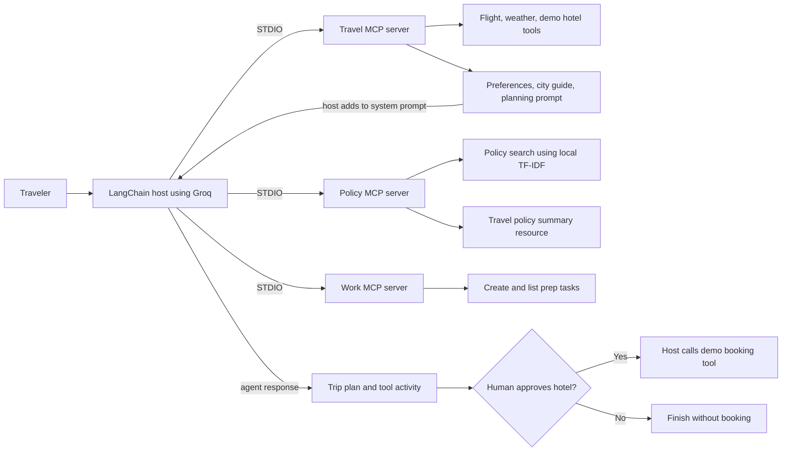

# Enterprise Business Trip Copilot (MCP End to End)

This is a hands-on learning project for the Model Context Protocol (MCP). It connects travel, policy, and work MCP servers to a Groq-backed LangChain agent. It demonstrates tools, resources, resource templates, prompts, retrieval-augmented generation, STDIO, Streamable HTTP, and human approval for a side-effecting action.

## Current Features

| MCP capability | Name | What it does |
| --- | --- | --- |
| Tool | `search_flights` | Returns two sample flight options for an origin and destination. |
| Tool | `get_live_weather` | Uses Open-Meteo geocoding and forecast APIs to return current temperature, humidity, and wind speed. |
| Tool | `book_hotel` | Returns a demo booking confirmation. The agent cannot call it; the host calls it only after approval. It does not contact a hotel service. |
| Resource | `travel://preferences` | Returns fixed airline, seat, class, and hotel preferences. |
| Resource template | `city://{city}/guide` | Returns short business-travel tips for the requested city. |
| Prompt | `plan_business_trip` | Returns numbered instructions for planning a trip without autonomously confirming a hotel booking. |
| Work tools | `create_trip_task`, `list_trip_tasks` | Create and list in-memory preparation tasks. A real service could use Jira or GitHub Issues. |
| Policy tool | `search_company_policy` | Ranks four demo policy documents using local TF-IDF vectors and cosine similarity. |
| Policy resource | `policy://travel-summary` | Returns a fixed summary of the demo travel policies. |

The three STDIO servers are in [`servers/`](servers/). The main host is [`app.py`](app.py). It reads resources and prompts explicitly, discovers tools from each server, prefixes their names, and adds selected tool calls to the LangChain agent. The Stage 1 client check is in [`tests/check_travel_server.py`](tests/check_travel_server.py).

## Requirements

- Python 3.10 or later
- Internet access for the live Open-Meteo weather lookup

The declared packages are listed in [`requirements.txt`](requirements.txt). The Groq chat model uses `GROQ_API_KEY`. Policy search uses local TF-IDF vectors, so it does not need a separate embeddings API key. Copy [`.env.example`](.env.example) to `.env` and set `GROQ_API_KEY` before running the agent. Do not commit `.env` or share its contents.

## Setup

Run these commands from the project root in PowerShell:

```powershell
python -m venv .venv
.\.venv\Scripts\Activate.ps1
python -m pip install -r requirements.txt
Copy-Item .env.example .env
```

Set your `GROQ_API_KEY` value in `.env`. The policy server builds and caches its local demo-document vectors on the first search. No embedding API call is made.

## Run the MCP Checks

The Stage 1 check launches the travel server over STDIO and exercises its tools, resource, resource template, and prompt:

```powershell
python tests\check_travel_server.py
```

The client starts the server process, so no separate terminal is needed. The weather tool needs internet access. The check calls the demo hotel tool directly; it does not make a real booking.

The work server can be exercised by running a small client script in PowerShell:

```powershell
@'
import asyncio
import sys
from pathlib import Path
from mcp import Client, StdioServerParameters

async def main():
    server = Path("servers/work_server.py").resolve()
    params = StdioServerParameters(command=sys.executable, args=[str(server)])
    async with Client(params) as client:
        tools = await client.list_tools()
        print("Available tools:", [tool.name for tool in tools.tools])
        result = await client.call_tool("list_trip_tasks", {})
        print("Tasks:", result.structured_content or result.content)

asyncio.run(main())
'@ | python -
```

The policy server exposes its summary resource without an API call. Policy search uses local TF-IDF vectorization and does not require an API key; the main agent invokes this search when it plans a trip.

## Run the Copilot

From the project root, run:

```powershell
python app.py
```

Press Enter to accept the defaults: Dubai, five days, and Bangalore. The host starts all three MCP servers over STDIO. It prints discovered tool names, then runs the agent. The `travel_book_hotel` tool is deliberately withheld from the agent. After the plan is printed, the host asks `Approve booking? (yes/no)`. Only `yes` calls the demo booking tool through a new travel-server client.

The model defaults to `openai/gpt-oss-20b`, hosted by Groq. Set `GROQ_MODEL` in `.env` to select another model available to your Groq account. If Groq rejects the model, the app prints a concise API error and recommends checking the configured model. The app does not set a reasoning-effort option.

## Run the HTTP Example

Start the server in one PowerShell terminal:

```powershell
python http-servers\travel_http_server.py
```

In a second terminal, from the project root, run:

```powershell
python app_http.py
```

The HTTP launcher imports the same `server` instance from `servers/travel_server.py`; it does not duplicate the tool/resource/prompt definitions. The client connects to `http://127.0.0.1:8001/mcp`, lists tools, calls flight search, reads travel preferences and the Dubai guide, and requests the trip-planning prompt. The local example uses HTTP on loopback. Use a TLS-terminating proxy or configure a trusted HTTPS endpoint before exposing it beyond the machine.

| Detail | STDIO | Streamable HTTP |
| --- | --- | --- |
| Who starts the server | The MCP client starts a local process. | You start the server separately. |
| Connection address | A local executable path and arguments. | A URL, such as `http://127.0.0.1:8001/mcp`. |
| Typical use | Local tools launched by one host. | A separately running local or remote service. |

## Project Files

```text
.
  app.py
  README.md
  requirements.txt
  .env.example
  servers/
    __init__.py
    travel_server.py
    policy_server.py
    work_server.py
  tests/
    check_travel_server.py
  http-servers/
    travel_http_server.py
  app_http.py
```

## Architecture Flow



## Future Considerations

The current code is a learning demo. It uses sample flights, sample work tasks, and sample policy text. The hotel function returns a fixed demo confirmation.

| Area | Current state | Future consideration |
| --- | --- | --- |
| Flight search | Returns two fixed examples. | Connect to an approved travel inventory API and show its update time and currency. |
| Hotel booking | Returns a fixed demo confirmation. | Integrate a booking provider, add authorization and idempotency, and retain an explicit approval step. |
| Work tasks | Stored in process memory and reset on restart. | Connect to Jira or GitHub Issues and apply user identity and project permissions. |
| Policy retrieval | Four demo documents are vectorized locally with TF-IDF and cached in process memory. | Use semantic embeddings and a managed vector database for larger corpora and improved semantic matching. |
| MCP-to-LangChain tools | `app.py` wraps tools discovered through native MCP 2.x clients. | Revisit the adapter when it supports MCP 2.x. The available `langchain-mcp-adapters` release currently requires `mcp<2.0`, which conflicts with this project's `mcp[cli]>=2.0` requirement. |
| HTTP transport | Local server binds to `127.0.0.1` without authentication. | Add authentication, TLS, network controls, observability, and deployment configuration before remote use. |
| Secrets | `.env` is ignored by Git; `.env.example` is safe to commit. | Use a managed secret store for deployed environments and rotate keys through a documented process. |

## What I Learned

- **Tools** are callable operations, such as flight search or task creation.
- **Resources** expose readable data; **resource templates** produce data from URI parameters.
- **Prompts** provide reusable instructions with named arguments.
- **STDIO** lets a client start a local server process; **Streamable HTTP** connects to a running server URL.
- A **multi-server host** can discover tools from separate servers and prefix names to avoid collisions.
- **RAG as a tool** vectorizes the query locally, ranks documents by cosine similarity, and returns policy evidence to the agent.
- **Human approval** keeps a side-effecting booking action outside autonomous agent tool selection.
- Reading resources and prompts does not send them to the model automatically; the host explicitly adds their content to the system prompt.

## Practice Exercises

1. Add a `search_trains` tool to the travel server and expose it to the agent.
2. Add a `city://{city}/meeting-checklist` resource template.
3. Add a fourth MCP server for calendar availability and include it in the host.
4. Add a fifth demo policy and test which query ranks it highest.
5. Replace the in-memory task list with a persistent store or an issue-tracker integration.