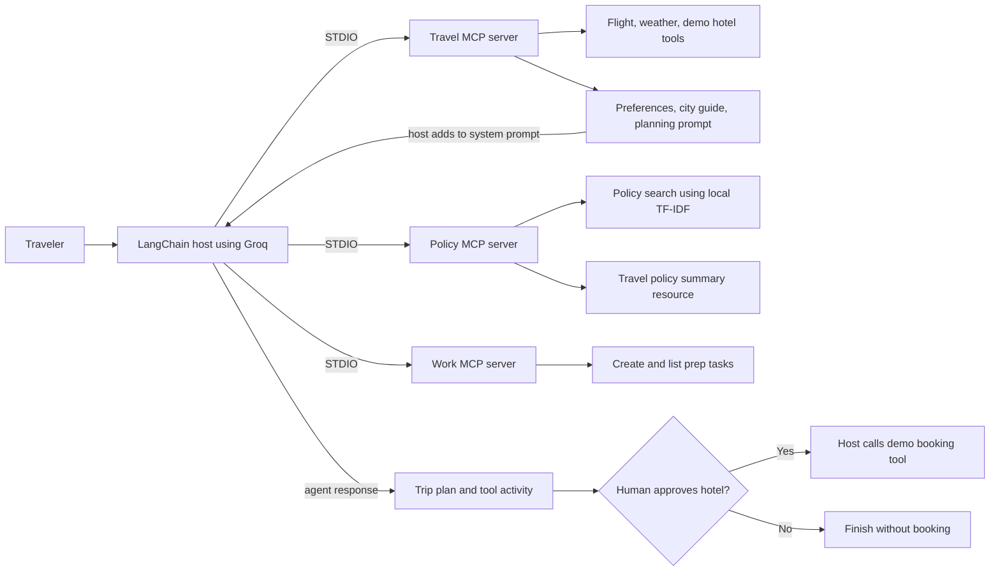
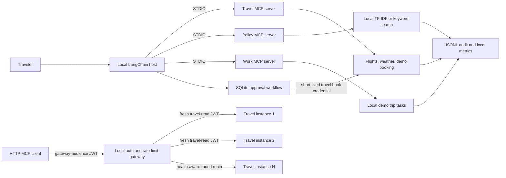

# Enterprise Business Trip Copilot (MCP End to End)

This is a hands-on learning project for the Model Context Protocol (MCP). It connects travel, policy, and work MCP servers to a Groq-backed LangChain agent. It demonstrates tools, resources, resource templates, prompts, retrieval-augmented generation, STDIO, Streamable HTTP, and human approval for a side-effecting action.

## Current Features

| MCP capability | Name | What it does |
| --- | --- | --- |
| Tool | `search_flights` | Returns two sample flight options for an origin and destination. |
| Tool | `get_live_weather` | Uses Open-Meteo geocoding and forecast APIs to return current temperature, humidity, and wind speed. |
| Tool | `book_hotel` | Returns a demo booking confirmation. The agent cannot call it; the host calls it only after approval. It does not contact a hotel service. |
| Resource | `travel://preferences` | Returns fixed airline, seat, class, and hotel preferences. |
| Resource template | `city://{city}/guide` | Returns short business-travel tips for the requested city. |
| Prompt | `plan_business_trip` | Returns numbered instructions for planning a trip without autonomously confirming a hotel booking. |
| Work tools | `create_trip_task`, `list_trip_tasks` | Create and list in-memory preparation tasks. A real service could use Jira or GitHub Issues. |
| Policy tool | `search_company_policy` | Returns short, cited chunks from four demo policy documents, ranked with local TF-IDF or offline keyword matching. |
| Policy resource | `policy://travel-summary` | Returns a fixed summary of the demo travel policies. |

The three STDIO servers are in [`servers/`](servers/). The main host is [`app.py`](app.py). It reads resources and prompts explicitly, discovers tools from each server, prefixes their names, and adds selected tool calls to the LangChain agent. The travel server is also exposed through [`http-servers/travel_http_server.py`](http-servers/travel_http_server.py), and the local scaling simulator is in [`gateway.py`](gateway.py) and [`scripts/run_cluster.py`](scripts/run_cluster.py). The STDIO client check is in [`tests/check_travel_server.py`](tests/check_travel_server.py).

## Requirements

- Python 3.10 or later
- Internet access for the live Open-Meteo weather lookup

The declared packages are listed in [`requirements.txt`](requirements.txt). The Groq chat model uses `GROQ_API_KEY`. Policy search uses local TF-IDF vectors, so it does not need a separate embeddings API key. Copy [`.env.example`](.env.example) to `.env` and set `GROQ_API_KEY` before running the agent. Do not commit `.env` or share its contents.

## Setup

Run these commands from the project root in PowerShell:

```powershell
python -m venv .venv
.\.venv\Scripts\Activate.ps1
python -m pip install -r requirements.txt
Copy-Item .env.example .env
```

Set your `GROQ_API_KEY` value in `.env`. The policy server builds its local demo-document TF-IDF index on the first search and persists it in `data/policy_vectors.json`. No embedding API call is made. Set `POLICY_SEARCH_MODE=offline` to use keyword matching without creating or reading that cache.

## Run the MCP Checks

The Stage 1 check launches the travel server over STDIO and exercises its tools, resource, resource template, and prompt:

```powershell
python tests\check_travel_server.py
```

The client starts the server process, so no separate terminal is needed. The weather tool needs internet access. The check exercises non-booking tools and resources; approval tests verify that a booking call without the approved scope is denied. No real booking is made.

The work server can be exercised by running a small client script in PowerShell:

```powershell
@'
import asyncio
import sys
from pathlib import Path
from mcp import Client, StdioServerParameters

async def main():
    server = Path("servers/work_server.py").resolve()
    params = StdioServerParameters(command=sys.executable, args=[str(server)])
    async with Client(params) as client:
        tools = await client.list_tools()
        print("Available tools:", [tool.name for tool in tools.tools])
        result = await client.call_tool("list_trip_tasks", {})
        print("Tasks:", result.structured_content or result.content)

asyncio.run(main())
'@ | python -
```

The policy server exposes its summary resource without an API call. Policy search uses local TF-IDF vectorization by default and does not require an API key; the main agent invokes this search when it plans a trip.

## Run the Copilot

From the project root, run:

```powershell
python app.py
```

Press Enter to accept the defaults: Dubai, five days, and Bangalore. The host starts all three MCP servers over STDIO. It prints discovered tool names, then runs the agent. The `travel_book_hotel` tool is deliberately withheld from the agent. After the plan is printed, the host checks the entered hotel rate against policy, records a pending approval with an expiry, and asks for a yes/no decision. Only an unexpired approval can issue a short-lived `travel:book` token and call the demo booking tool.

The model defaults to `openai/gpt-oss-20b`, hosted by Groq. Set `GROQ_MODEL` in `.env` to select another model available to your Groq account. If Groq rejects the model, the app prints a concise API error and recommends checking the configured model. The app does not set a reasoning-effort option.

## Run the HTTP Example

Start the server in one PowerShell terminal:

```powershell
python http-servers\travel_http_server.py
```

In a second terminal, from the project root, run:

```powershell
python app_http.py
```

The HTTP launcher imports the same `server` instance from `servers/travel_server.py`; it does not duplicate the tool/resource/prompt definitions. The client connects to `http://127.0.0.1:8001/mcp`, lists tools, calls flight search, reads travel preferences and the Dubai guide, and requests the trip-planning prompt. The local example uses HTTP on loopback. Use a TLS-terminating proxy or configure a trusted HTTPS endpoint before exposing it beyond the machine.

| Detail | STDIO | Streamable HTTP |
| --- | --- | --- |
| Who starts the server | The MCP client starts a local process. | You start the server separately. |
| Connection address | A local executable path and arguments. | A URL, such as `http://127.0.0.1:8001/mcp`. |
| Typical use | Local tools launched by one host. | A separately running local or remote service. |

## Project Files

```text
.
  app.py
  README.md
  requirements.txt
  .env.example
  servers/
    __init__.py
    travel_server.py
    policy_server.py
    work_server.py
  tests/
    check_travel_server.py
  http-servers/
    travel_http_server.py
  app_http.py
```

## Architecture Flow



## Future Considerations

The current code is a learning demo. It uses sample flights, sample work tasks, and sample policy text. The hotel function returns a fixed demo confirmation.

| Area | Current state | Future consideration |
| --- | --- | --- |
| Flight search | Returns two fixed examples. | Connect to an approved travel inventory API and show its update time and currency. |
| Hotel booking | Returns a fixed demo confirmation. | Integrate a booking provider, add authorization and idempotency, and retain an explicit approval step. |
| Work tasks | Stored in process memory and reset on restart. | Connect to Jira or GitHub Issues and apply user identity and project permissions. |
| Policy retrieval | Four demo documents are ranked locally with TF-IDF or keyword matching; TF-IDF vectors are stored in a content-hash-validated local JSON cache. | Generate semantic embeddings and store vectors plus metadata in a vector database for larger corpora and improved semantic matching. |
| Observability | JSONL audit events contain tool, caller, request ID, argument hash, status, and latency; process-local metrics are exposed for the travel HTTP server. | Centralized, access-controlled logs and metrics with distributed traces, retention, and tamper-resistant audit policies. |
| Local scaling | One localhost gateway round-robins across a small set of travel processes and mints a new least-privilege token per backend. | Load balancing, service discovery, distributed rate limiting, autoscaling, and shared state across multiple hosts. |
| Prompt injection | MCP-sourced text is escaped and delimited as untrusted context; the booking tool is excluded from agent tools. | Model-specific defense-in-depth, content classification, policy enforcement, and adversarial evaluation against evolving attacks. |
| MCP-to-LangChain tools | `app.py` wraps tools discovered through native MCP 2.x clients. | Revisit the adapter when it supports MCP 2.x. The available `langchain-mcp-adapters` release currently requires `mcp<2.0`, which conflicts with this project's `mcp[cli]>=2.0` requirement. |
| HTTP transport | Travel endpoint uses audience- and scope-checked JWTs on loopback; local health/metrics routes are public. | Add TLS, network controls, authenticated operational endpoints, and deployment-managed identity before remote use. |
| Secrets | `.env` is ignored by Git; `.env.example` is safe to commit. | Use a managed secret store for deployed environments and rotate keys through a documented process. |

## What I Learned

- **Tools** are callable operations, such as flight search or task creation.
- **Resources** expose readable data; **resource templates** produce data from URI parameters.
- **Prompts** provide reusable instructions with named arguments.
- **STDIO** lets a client start a local server process; **Streamable HTTP** connects to a running server URL.
- A **multi-server host** can discover tools from separate servers and prefix names to avoid collisions.
- **RAG as a tool** vectorizes the query locally, ranks documents by cosine similarity, and returns cited policy evidence to the agent.
- **Human approval** keeps a side-effecting booking action outside autonomous agent tool selection.
- Reading resources and prompts does not send them to the model automatically; the host explicitly adds their content to the system prompt.

## Practice Exercises

1. Add a `search_trains` tool to the travel server and expose it to the agent.
2. Add a `city://{city}/meeting-checklist` resource template.
3. Add a fourth MCP server for calendar availability and include it in the host.
4. Add a fifth demo policy and test which query ranks it highest.
5. Replace the in-memory task list with a persistent store or an issue-tracker integration.

## Local configuration (Stage 1)

Copy `.env.example` to `.env` and override values as needed. `settings.py` resolves
the MCP host, per-server URLs and ports, gateway port, Groq model, HTTP and weather
timeouts, local SQLite path, token secret, and log level from environment variables.
HTTP URLs default from `MCP_HOST` and the configured server ports; set
`TRAVEL_HTTP_URL`, `POLICY_HTTP_URL`, or `WORK_HTTP_URL` only when an explicit
endpoint override is needed.
The current HTTP travel launcher and client use the shared settings; STDIO server
paths and launch behavior remain unchanged. `TOKEN_SECRET` in the example is only
a placeholder for local development and must not be used as a production secret.

The default HTTP travel endpoint remains `http://127.0.0.1:8001/mcp`. Logs are
written to stderr so they do not interfere with MCP's STDIO transport. Run the
configuration tests with `python -m pytest`.

## Local HTTP authentication (Stage 2)

The Streamable HTTP travel server requires a signed, short-lived bearer token
with the `travel:read` scope and an audience matching its configured MCP URL.
`app_http.py` mints and sends a travel-read-only development token; it does not
forward an incoming token to another service. The booking tool also requires
`travel:book` on authenticated HTTP requests, and the local token CLI deliberately
does not offer that scope. The STDIO server behavior remains available to the host
and existing STDIO checks.

To issue a local non-booking token for a server, set `TOKEN_SECRET` in `.env` and
run `python scripts\issue_token.py --server-url http://127.0.0.1:8001/mcp`.
The example secret is for local development only. Do not reuse it outside the
laptop demo or expose the HTTP server beyond loopback.

Authentication tests, including missing/bad/expired tokens, wrong audience,
missing scope, a valid token, and booking scope enforcement, run with
`python -m pytest`.

## Tool validation and idempotency (Stage 3)

Travel, work, and policy tools validate their inputs and cap returned collections.
`book_hotel` and `create_trip_task` require an `idempotency_key`; SQLite stores the
result for retries. Reusing a key with different parameters is rejected. The
database is created locally at `DATABASE_PATH` (default
`data/business_trip.sqlite3`); no external database is needed.

The weather lookup uses the configured timeout, retries transient failures up to
three times with exponential backoff, and returns `ok`, `error`, and `retryable`
fields on failure. The response body is size-capped. Run all validation and
idempotency tests with `python -m pytest -q`.

## Human booking approval (Stage 4)

The host checks the requested hotel nightly rate against the local policy limit
(INR 12,000) before writing a pending action. A valid request is persisted in
SQLite and expires after `APPROVAL_TTL_MINUTES` (default 5). The CLI displays the
expiry and asks for a human yes/no decision. Only an unexpired approval issues a
short-lived local `travel:book` JWT and invokes `book_hotel`; the tool stays out
of the agent's tool list. Approval decisions and booking outcomes are written to
the local `audit_records` table.

The workflow is laptop-only and uses dummy data. Approval/authentication tokens,
SQLite audit data, and the CLI are not substitutes for production identity,
separation of duties, or tamper-resistant audit storage. Run approval workflow
tests with `python -m pytest -q tests\test_approval_service.py`.

## Offline policy retrieval (Stage 5)

Policy retrieval is local and needs no OpenAI key or network connection. Set
`POLICY_SEARCH_MODE=tfidf` (the default) to use cosine similarity over locally
computed TF-IDF vectors. The first search writes the index to
`POLICY_CACHE_PATH` (default `data/policy_vectors.json`); subsequent searches
load the cached vectors. A SHA-256 hash of the policy IDs and content invalidates
the index automatically when any document changes. This generated cache is
ignored by Git.

Set `POLICY_SEARCH_MODE=offline` to use lightweight keyword-overlap ranking;
this mode does not read or write the vector cache. Both modes return bounded
chunks with stable `document_id` citations, titles, and relevance scores. Run
`python -m pytest -q` for cache reuse/invalidation, offline-mode, citation, and
input-bound tests.

In production, a larger and frequently updated policy corpus would typically
use model-generated embeddings plus a vector database containing vectors,
document IDs, policy versions, and access-control metadata. The local TF-IDF
index is a deterministic laptop-scale substitute, not a production vector
database or semantic embedding model.

## Observability and audit (Stage 6)

Travel, policy, and work tools emit one JSONL audit event per invocation to
`AUDIT_LOG_PATH` (default `data/tool_audit.jsonl`). Each event records a timestamp,
request ID, caller subject where available, tool name, SHA-256 hash of arguments,
status, and latency; raw argument values are not written. The file and metrics
are local demo data and are ignored by Git. The travel HTTP server exposes
unauthenticated local `/health` and `/metrics` routes for readiness and in-process
call/error/p50/p95 counters. With the travel server running, inspect the counters:

```powershell
python scripts\show_metrics.py
```

Optional LangSmith tracing is disabled by default. Set `LANGSMITH_TRACING=true`
and configure the LangSmith credentials in your local `.env` only if you
intentionally want telemetry sent to that external service.

## Local scaling simulation (Stage 7)

The round-robin gateway and all instances bind only to `MCP_HOST` (default
`127.0.0.1`). Configure `CLUSTER_BASE_PORT`, `CLUSTER_SIZE` (1-8), `GATEWAY_PORT`,
and the `GATEWAY_RATE_*` settings in `.env`. Defaults are three small travel
processes, 100 burst tokens, and 50 tokens/second. Backend health checks time
out after `GATEWAY_HEALTH_TIMEOUT_SECONDS` (default 0.5 seconds). Start the
cluster together:

```powershell
python scripts\run_cluster.py
```

In another terminal, issue a gateway-audience read token and run the default
50-request/10-concurrent load test:

```powershell
python scripts\load_test.py
```

The load test creates its own short-lived local read token for convenience;
use `scripts\issue_token.py --server-url http://127.0.0.1:8000/mcp` when testing
with another client. It reports success,
p50/p95 latency, and requests per instance. To test failover, stop one printed
travel-server PID from another PowerShell window using
`Stop-Process -Id <that-PID>`; new requests should continue through the remaining
healthy instances. Stop the cluster with Ctrl+C in its original terminal. The
gateway validates the client JWT for its own audience, rate-limits by subject,
and mints a new short-lived `travel:read` JWT for the selected server. It never
forwards the caller's bearer token and cannot grant `travel:book`. This is a
single-machine simulation, not a production load balancer.

## Prompt-injection checks (Stage 8)

Resources, prompts, and MCP tool results are escaped and wrapped in
`<untrusted_context>` delimiters. The system prompt explicitly treats this text
as reference data, not instructions. The booking tool remains absent from the
agent's tool list and the approval workflow remains the only supported booking
path. Deterministic malicious-document and tool-exclusion checks run with:

```powershell
python -m pytest -q tests\test_prompt_injection.py
```

The tests do not claim that delimiters alone solve prompt injection; the
non-agent booking authorization check is an independent enforcement boundary.

## One-command local verification (Stage 9)

Run the preflight report, full tests, STDIO smoke check, and an authenticated
HTTP app smoke check with:

```powershell
python scripts\check_all.py
```

The interactive Groq-backed agent is not called by default, even if a key is
configured. To explicitly opt into a live model request (which may use API
quota), run `python scripts\check_all.py --include-llm`. Stage 0 prerequisites
are reported by `python scripts\preflight.py`.

## Docker Compose (Stage 10: not enabled)

This stage is optional and requires Docker to be installed and running, followed
by explicit approval to proceed. Docker was not available in the Stage 0 laptop
preflight, so no Dockerfile or Compose stack was added. All stages completed
here run locally without Docker.

## Complete local architecture and production gaps (Stage 11)



| Local learning implementation | Production approach |
| --- | --- |
| Loopback JWT secret and local issuer | Managed identity provider, asymmetric signing keys, rotation, and per-user authorization |
| SQLite idempotency and approval records | Shared transactional database, outbox/retry strategy, and multi-approver workflow |
| Local TF-IDF cache and keyword mode | Versioned embeddings, vector database, access filters, and retrieval evaluation |
| Local JSONL events and in-process counters | Centralized observability, trace propagation, protected audit retention, and alerting |
| Three local processes and a Python gateway | Highly available load balancer, service discovery, autoscaling, distributed rate limits, and shared state |
| Escaped context boundaries and hidden booking tool | Layered prompt-injection defenses, policy checks, and continuous adversarial testing |
| Demo data and localhost-only HTTP | Real provider integrations, TLS, secrets management, privacy/compliance controls, and disaster recovery |

Stage 11 closes the learning sequence; it documents how to explain the system
and its trade-offs rather than adding another runtime dependency.