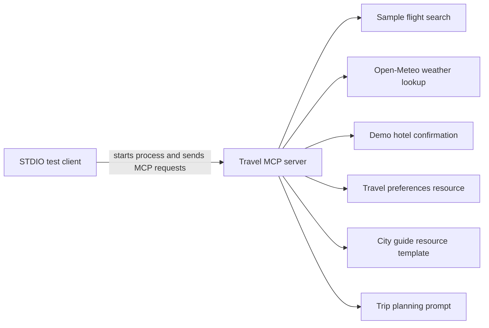
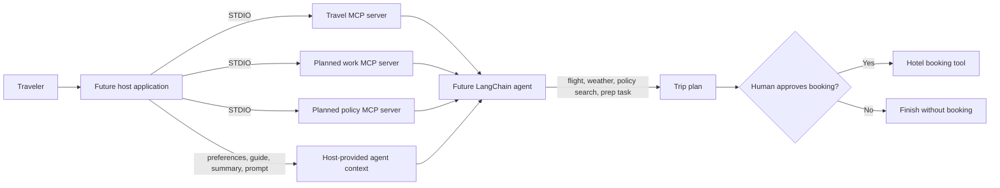

# Enterprise Business Trip Copilot (MCP End to End)

This is a hands-on learning project for the Model Context Protocol (MCP). Its current Stage 1 implementation connects a small travel MCP server to an MCP client over STDIO, demonstrating tools, resources, a resource template, and a prompt. Later agent and multi-server stages are not implemented yet.

## Current Features

| MCP capability | Name | What it does |
| --- | --- | --- |
| Tool | `search_flights` | Returns two sample flight options for an origin and destination. |
| Tool | `get_live_weather` | Uses Open-Meteo geocoding and forecast APIs to return current temperature, humidity, and wind speed. |
| Tool | `book_hotel` | Returns a demo booking confirmation. This tool represents a side effect, but does not contact a hotel service. |
| Resource | `travel://preferences` | Returns fixed airline, seat, class, and hotel preferences. |
| Resource template | `city://{city}/guide` | Returns short business-travel tips for the requested city. |
| Prompt | `plan_business_trip` | Returns numbered instructions for planning a trip without autonomously confirming a hotel booking. |

The server is defined in [`servers/travel_server.py`](servers/travel_server.py). The client check in [`tests/check_travel_server.py`](tests/check_travel_server.py) launches it as a subprocess using the current Python interpreter and communicates with it over STDIO.

## Requirements

- Python 3.10 or later
- Internet access for the live Open-Meteo weather lookup

The declared packages are listed in [`requirements.txt`](requirements.txt). LangChain packages and `python-dotenv` are included for the planned later stages; the current Stage 1 code does not use them. The `.env.example` file is a placeholder for a future API key and is not loaded by Stage 1.

## Setup

Run these commands from the project root in PowerShell:

```powershell
python -m venv .venv
.\.venv\Scripts\Activate.ps1
python -m pip install -r requirements.txt
```

## Run the Stage 1 Check

From the project root, run:

```powershell
python tests\check_travel_server.py
```

The client starts `servers/travel_server.py` itself. No separate server terminal is needed for this check. It lists and calls the tools, reads the fixed resource and a city-specific resource, lists the resource template, and requests the trip-planning prompt. The weather result depends on the network and Open-Meteo response. The hotel call is demo-only.

## Project Files

```text
business_trip_copilot_mcp/
  README.md
  requirements.txt
  .env.example
  servers/
    __init__.py
    travel_server.py
  tests/
    check_travel_server.py
```

## Implemented Flow



## Future Considerations

This section describes the intended architecture for later learning stages. These capabilities are not present in the current source tree.

### Planned Multi-Server Agent Flow

The intended end-to-end design can grow from the current travel server to work and policy MCP servers. A host application can gather resources and prompts, select tools for a LangChain agent, and keep the hotel booking behind an explicit human approval step.



In that design, tools are callable operations, resources provide data for the host to read, and prompts provide reusable instructions. Reading a resource or prompt does not by itself send that content to a language model; the host must include relevant context when it constructs the agent request.

### Design Considerations

| Area | Current state | Future consideration |
| --- | --- | --- |
| Server count | One travel server. | Add separate work and policy servers, then connect all of them from the host. |
| Policy search | Not implemented. | A policy MCP tool could retrieve relevant company-policy documents; a production system would typically use a maintained vector store and access controls. |
| Agent | Not implemented. | Use a LangChain MCP adapter to expose tools from multiple STDIO servers to an agent. Confirm tool names and adapter behavior against installed package versions. |
| Booking approval | The server has a demo booking tool; Stage 1's test calls it directly. | In an agent host, keep side-effecting booking out of autonomous tool selection and invoke it only after explicit human approval. |
| Transport | STDIO, where the client launches the server process. | A later HTTP transport could let a separately running server accept requests at a URL, which is useful when processes are not launched together. |
| Secrets | `.env.example` contains an empty `OPENAI_API_KEY` entry. | Load secrets from a local `.env` file or a managed secret store only when a later stage needs them; do not commit real credentials. |

## What This Stage Teaches

- **Tools** let an MCP client request operations from a server.
- **Resources** expose readable server data, while **resource templates** vary data by URI parameters.
- **Prompts** let a client request reusable instructions by name and provide arguments.
- With **STDIO**, the client starts the server process and exchanges MCP messages through standard input and output.
- Side-effecting actions such as a real booking should require deliberate authorization in a host application.